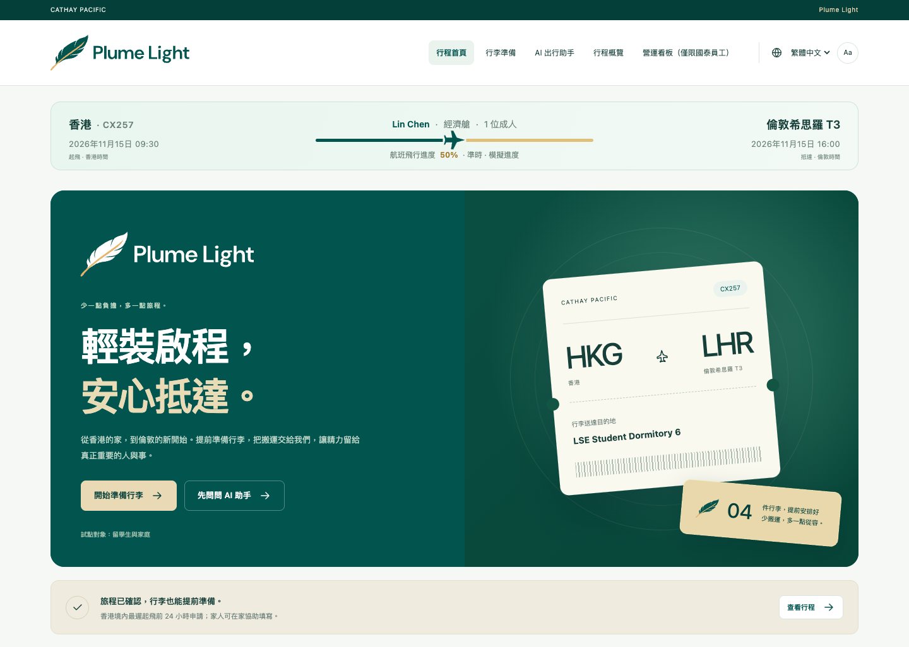
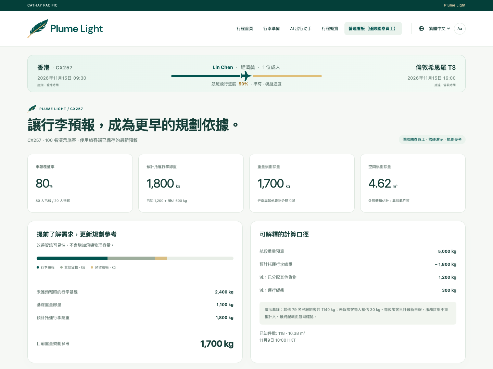

<p align="center">
  
</p>

# 泰易送 · 翼隨行 — Plume Light

<p align="center"><strong>輕裝啟程，安心抵達。</strong><br>Less to carry. More to discover.</p>

<p align="center">
  <a href="#界面預覽">界面預覽</a> ·
  <a href="#快速開始">快速開始</a> ·
  <a href="#產品功能與頁面導覽">頁面導覽</a> ·
  <a href="#推薦演示流程">演示流程</a> ·
  <a href="#開發與驗證">開發與驗證</a>
</p>

面向國泰航班旅客的行李準備與遞送服務概念原型，為 Cathay Hackathon 項目製作。旅客可以提前申報行李、諮詢攜帶規則、模擬預約上門收取及目的地配送；航司可通過營運看板查看已保存的行李預報，輔助裝載規劃。

**試點聚焦留學生與家庭。** 從香港的家到倫敦的新開始，把行李準備、取送安排和交接確認串成一段完整旅程。

項目使用 **React + TypeScript + Vite**，保留首頁與各功能的獨立網址。源碼需要先構建或由 Vite 啟動，不能以 `file://` 雙擊 HTML 使用。**根目錄的 `index.html` 是首頁入口。** 本說明位於根目錄 `README.md`。

> 當前為靜態交互演示，沒有接入真實訂票、付款、會員或物流服務。AI 助手可透過本地 Python 服務接入 GLM；需要有效 API key 和可用額度。頁面中的價格、里數、時間、規則和交接事件均為演示數據。

## 界面預覽

### 一趟旅程，從提前準備開始



首頁把航班、行李準備入口、目的地和旅客故事放在一起。默認故事圍繞 Lin Chen 的 `HKG → LHR` 留學旅程展開，行李送達 `LSE Student Dormitory 6`。

| 出發前 | 預約時 | 抵達後 |
| --- | --- | --- |
| 填寫行李，先問清攜帶規則 | 比較隨航班與 Cargo，核對現金及里數 | 查看機場到達、裝機和當地物流交接三項確認 |

[價格計算](pages/pricing.html)使用三個泳道分配行李，並即時更新總價。香港取送套餐擬議價格為每單 HK$1,200，額外托運行李費及 Cargo 運費另計。

<details>
<summary><strong>查看營運看板：從行李預報到裝載規劃參考</strong></summary>



旅客保存的最新預報會進入看板，與其他演示旅客數據彙總。已知重量和未申報補估分別展示，方便解釋規劃餘量如何變化；最終配載仍由航司確認。

</details>

以上截圖來自當前頁面的默認繁體中文演示場景，使用項目本地素材。

### 先認識兩位試點場景中的旅客

<table>
  <tr>
    <th width="50%">Lin · 獨自赴英升學</th>
    <th width="50%">Alex · 與家人提前安排旅程</th>
  </tr>
  <tr>
    <td align="center"></td>
    <td align="center"></td>
  </tr>
  <tr>
    <td><strong>香港 → 倫敦</strong><br>兩隻行李箱、兩箱書籍衣物。提前填寫行李資料，安排宿舍配送，把抵達後的精力留給入住和新生活。</td>
    <td><strong>深圳 → 香港 → 墨爾本</strong><br>家人在家協助填寫預報和跨境取件資料，由目的地家人接收行李；兒童乘機服務另按航司流程確認。</td>
  </tr>
</table>

人物與故事均為虛構，配圖為項目已有的 AI 生成素材。首頁另有研究學者案例，用於展示後續擴展場景；行動不便旅客服務按 deck 規劃於 2029 年以後拓展。

## 快速開始

### 下載後一鍵預覽（推薦）

先安裝 **Node.js 24 LTS** 與 **Python 3.9+**，下載完整倉庫並解壓後：

- macOS：雙擊根目錄的 `start.command`。若沒有執行權限，在終端執行 `sh start.command`。
- Windows：雙擊根目錄的 `start.bat`。
- 任意系統：在項目根目錄執行 `npm start`。

腳本會按 `package-lock.json` 安裝依賴（首次或鎖文件變更時需要聯網）、重新構建當前 React 源碼、啟動 Python 服務，並開啟 <http://127.0.0.1:8000/>。保留終端視窗，按 `Ctrl+C` 停止。若端口被佔用，macOS/Linux 可執行 `PLUME_PORT=8001 npm start`。無 GLM 密鑰時，在助手頁切換「離線規則演示」。

**請勿直接打開源碼或 `dist/index.html`。** 它們使用瀏覽器 ES modules，需要 HTTP 服務。

### Docker 一條命令啟動

已安裝並啟動 Docker 時，在項目根目錄執行：

```sh
docker compose up --build
```

然後開啟 <http://127.0.0.1:8080/>。容器內含 React 構建與 Python API，主機無需安裝 Node.js 或 Python。按 `Ctrl+C` 停止。

### 開發伺服器

在項目根目錄使用 Node.js 22.12+ 運行以下命令，再開啟 [Plume Light 本地首頁](http://localhost:5173/)。

```sh
npm ci
npm run dev
```

另開終端啟動 Python API，供 GLM 助手與模擬查件使用。Vite 會將 `/api` 轉發至 `127.0.0.1:8000`，可用 `PLUME_API_ORIGIN` 更改後端地址。

```sh
python3 tools/serve.py --port 8000
```

如需 GLM，在 Python 啟動命令加上 `--api-key-file /path/to/glm-key.txt`。其他配置見 [AI Agent 接入指南](doc/AI_AGENT.md)。無後端時，可在助手頁選擇「離線規則演示」。

請在演示過程中使用同一個瀏覽器、網址和端口。不同網址來源的瀏覽器存儲各自獨立。

全部服務行李完成當地物流交接後，行程頁會呼叫 `POST /api/handover/tracking`。接口接收訂單識別資料和逐件交接記錄，交接未齊時回傳 `status: "pending"`，確認齊全時回傳演示運單號、承運商及查件連結。EBC UK 的查件連結待提供。運單號由本地演示服務產生，正式單號須由承運商發出。

## 產品功能與頁面導覽

| 頁面入口 | 當前實現 | 建議體驗 |
| --- | --- | --- |
| [行程首頁](index.html) | CX257 航班橫幅、服務入口、三組虛構旅客案例與輪播 | 查看 Lin 的行程，切換人物故事 |
| [① 乘機人](pages/prepare.html) | 顯示乘機人和免費托運額，可邀請已互聯的家庭成員代填 | 勾選「由他人協助」以查看聯絡人選擇或新增聯絡人提示 |
| [② 信息預留](pages/information.html) | 根據機票識別國家，分開填寫取送地址與服務商，展示最遲下單時間 | 查看適用的 24／48／120 小時下單規則 |
| [③ 行李預報](pages/baggage.html) | 逐件填寫名稱、類別、重量及尺寸 | 多選物品類別並保存 |
| [④ 價格計算](pages/pricing.html) | 拖動行李卡片至隨身、跟機或 Cargo 泳道 | 在泳道間拖動行李，於結算頁核對費用 |
| [⑤ 確認結算](pages/checkout.html) | 查看費用及里數，模擬現金支付或里數兌換，保存訂單快照 | 核對免費額與加購，選擇一種模擬付款方式 |
| [AI 出行助手](pages/assistant.html) | 獨立諮詢入口，支持物品規則及價格、截止、配送等服務問題 | 先問“最遲什麼時候申請？”再進入預訂 |
| [行程概覽](pages/journey.html) | 查看訂單、模擬取消與退款，確認機場到達、裝機及當地物流交接 | 付款後展開交接演示，觀察逐件確認 |
| [家庭專區](pages/benefits.html) | 家庭權益、家庭互聯成員和邀請流程 | 切換至家庭互聯，模擬已互聯或未互聯 |
| [營運看板](pages/operations.html) | 彙總已保存預報，展示重量、空間、估算值及規劃餘量，標注僅限國泰員工 | 對比修改並保存行李前後的規劃參考 |

上表鏈接用於定位項目文件；在 GitHub 中點擊會打開源碼。請按「快速開始」啟動本地開發伺服器後體驗互動。

全站支持繁體中文、英語、法語、西班牙語和阿拉伯語，提供大字模式、鍵盤操作及減少動畫偏好；阿拉伯語會切換為從右向左的佈局。

### 品牌與界面約定

- 中文項目名稱為「**泰易送 · 翼隨行**」，網站頁首與頁尾使用 **Plume Light** 橫版 Logo，頂欄標注 `CATHAY PACIFIC`。
- 淺色背景使用標準版 Logo，首頁深綠色主視覺使用反白版；羽毛圖標也用於行李標籤、預訂摘要、助手頭像和瀏覽器標籤圖標。
- 首頁及全部預訂步驟的底部展示服務聲明：「我們嚴格保密乘客及其行李相關的隱私與資訊。」
- 營運入口及看板頁明確標注「僅限國泰員工」。目前這是界面用途說明，尚未實現員工登錄或訪問權限校驗。

### 運輸方式

行李預報只填行李資料。在「價格計算」把每件行李拖到以下三個泳道；也可用鍵盤聚焦拖曳把手，按 Enter 抓取、方向鍵選泳道，再按 Enter 放下：

| 選項 | 頁面表達 |
| --- | --- |
| 隨身攜帶 | 單件重量低於 7 kg，自行攜帶 |
| 行李隨本趟航班 | 與當前 CX257 旅程同行，界面標明時效較高 |
| 由 Cathay Cargo 調度 | 界面標明時效較低，可能更早交付行李並分開抵達，以確認安排為準 |

選擇會跨頁面保存，並進入結算摘要和訂單快照；Cargo 訂單的裝機說明也會顯示 Cathay Cargo。兩種方式使用不同演示運價，共用地區申請截止邏輯；沒有接入實際貨運排期、艙位分配或到達承諾。

### 家庭互聯與代填

在「家庭專區」切換至「家庭互聯」，可新增邀請、查看待接受或已互聯成員，也可切換已互聯及未互聯的演示狀態。在「乘機人」勾選由他人協助後，系統會提示新增聯絡人，或提供已互聯成員的單選列表及會員號、手機和關係。送出模擬郵件後顯示等待狀態，也可開始新申請。每次重新進入乘機人頁，協助選項會重設為未勾選。

### 機票免費額識別與加購

系統從當前機票的 `flight.baggageAllowance` 讀取乘機人的免費額度，按 `bookingId` 和 `travellerId` 匹配。默認演示成人票為免費 2 件、每件 23 kg；兒童票為免費 1 件、每件 23 kg。這些是本地票據樣本，並非從國泰實際出票系統提取的規則。

- 隨航班方案按當前乘機人的全部托運行李核對額度，包括未購買遞送服務的托運行李。
- 系統自動抵扣免費件數，只計算實際超出的件數，再由旅客一鍵確認加購。缺少確認時，預計總價已包含所需加購費，但不能繼續結算。
- 未超出免費額時，跟機行李費為 HKD 0，不收同航班安排費，也不要求加購確認；取件及目的地配送服務費仍單列。減少行李後，舊加購數量不能繼續產生超額費用。
- 免費額及加購數量按乘機人保存。額外件數不能合併用於抵銷單件超重；需先重新分裝或改選 Cargo。
- Cargo 行李不佔用機票免費額；未交給 Cargo 的托運行李仍按機票額度檢查和加購。
- 切換運輸方式、數量或行李資料會更新總價、里數及現金收益。訂單保存確認時的免費額、加購數量和費用快照。

| 新增演示費率 | 參數 |
| --- | --- |
| 免費額內跟機行李 | HKD 0，無同航班安排費 |
| 跟機額外托運行李 | 每件 HKD 600，沿用票據的單件重量上限 |
| Cargo 運費 | 每件每 23 kg 或不足一單位 HKD 250 |
| Cargo 計費重量 | 每件取實重與體積重的較高者，體積重 = 長 × 寬 × 高（cm）÷ 6000，再逐件向上取整計費單位 |

取送服務費按每單一次的套餐及收取地區系數計算。Cargo 的額外運輸單價較低；具體總價還受重量、體積、地區與跟機剩餘行李影響，不能保證任意行李組合下都更便宜。

## 目錄與頁面

```text
index.html / pages/     # 保留首頁及各功能的直達網址
src/main.tsx            # React 入口與 QueryClient
src/App.tsx             # 共用版面和頁面切換
src/pages/              # 首頁、預訂、助手、行程、家庭專區、營運
src/components/         # 共用元件、CSS Modules 與互動控制
src/engine/             # 報價、行李、家庭互聯、訂單及離線規則
src/services/           # DataSource、API 快取、瀏覽器存儲及介面事件
src/config/             # 頁面映射、演示資料、五語文案及全局設計變量
src/types/              # 業務資料型別與 DataSource 介面
assets/                 # 本地圖片及品牌素材
tools/                  # Python 助手、模擬查件 API 和測試
```

`archive/`、`family_member_order/` 與 `video/` 保留為獨立參考素材。

## 推薦演示流程

1. 打開首頁，展示 CX257 香港至倫敦希思羅 T3 的行程及目的地 `LSE Student Dormitory 6`；切換語言或大字模式。
2. 點擊「行李準備」，確認實際乘機人及聯繫人；需要時選擇家人協助填寫。
3. 在信息預留確認下單截止，分別填寫取件和送件資料；再填妥各件行李並保存預報。
4. 在價格計算頁將行李拖至隨身、隨航班或 Cargo 泳道，查看即時費用。
5. 有物品規則疑問時，可從主導覽進入獨立 AI 出行助手。
6. 核對報價，勾選模擬交易確認，選擇現金或里數結算，進入行程概覽。
7. 展開交接事件演示，依序確認到達機場、部分或全部裝機、當地物流接收；服務完成後再查看里數入賬。
8. 查看營運看板，觀察已保存申報及重量、空間餘量變化；最後回到首頁查看旅客案例。

頁面底部的演示控制台可切換留學生、兒童家庭、超過截止時間、缺少尺寸等場景，並調整演示時鐘、航班時間、規則質量或模擬支付失敗。

## 演示參數與業務約束

### 默認場景

- 航班：`CX257`，`HKG → LHR T3`，Lin Chen 乘坐經濟艙。
- 出發：2026 年 11 月 15 日 09:30，香港時間。
- 初始演示時鐘：2026 年 11 月 10 日 09:30，香港時間；不會自動隨系統日期推進。
- 默認托運行李：4 件，總重 60 kg；其中 3 件選用取送服務，共 50 kg，餘下 1 件於價格計算頁放入隨身泳道。
- 香港取送服務擬議價格：每次 HK$1,200；額外托運行李費或 Cargo 運費另計。
- 默認可用里數：100,000。
- 默認價格計算方案（3 件跟機取送、1 件隨身）：取送 HKD 1,200 + 1 件超額托運 HKD 600 = HKD 1,800。
- 默認 Cargo 方案（3 件經 Cargo，餘下 1 件隨身）：取送 HKD 1,200 + Cargo 運費 HKD 750 = HKD 1,950；需 48,750 里數兌換，現金訂單預計賺取 195 里數。Cargo 樣本計費重量為 56 kg，逐件取整後共 3 個計費單位。

上述價格依賴默認行李、地區及尺寸；修改選項後以頁面重新計算的演示報價為準。

### 申請截止

| 收取地區文案 | 至少提前申請 | 取件距起飛的最少間隔 |
| --- | --- | --- |
| 香港境內 | 24 小時 | 12 小時 |
| 大灣區其他覆蓋地區 | 48 小時 | 24 小時 |
| 出發國境內其他地區 | 120 小時 | 72 小時 |

以當前演示航班的香港出發時刻計算連續小時，恰好等於申請截止時刻仍可申請。取件時間還須符合單獨的運輸截點。其他未覆蓋地區不能新建預約。

「出發國境內其他地區」是當前顯示名稱；代碼沿用地區鍵 `mainland` 及相應演示參數，尚未實現按任意出發國動態配置覆蓋範圍。

### 行李、訂單與里數

- 全部托運行李預報與購買首末程服務的行李分別統計；服務報價只計算選中的托運行李。
- 同一乘機人及航段按最新有效申報統計。未知重量不當作零；報價需要完整重量與尺寸。
- 演示匯率為 GBP 1 = HKD 10；每 HKD 1 可用 25 里數兌換；每 HKD 10 合資格現金預計賺取 1 里數。這些是代碼演示參數，不是現行會員政策。
- 全額里數兌換訂單賺取 0 里數。付款失敗會釋放凍結里數；取消按訂單快照處理退款與已入賬里數衝銷。
- 訂單保存確認時的資料和運輸方式；後續草稿修改不會改寫已有訂單。
- 付款成功或航班進度變化不會自動確認行李裝機。交接按行李件數確認，可展示部分完成，並防止相同事件重複累計。
- 營運看板的餘量是演示預測，未接入真實航班載重或貨運銷售系統。

## AI 助手與案例

助手預設使用服務端 GLM agent，支援多輪對話及四個只讀工具，查詢目前行程、行李、確定性報價和項目服務規則。模型可以解釋方案、規劃準備清單及追問物品屬性，不能自行付款、更改訂單或確認行李交接。密鑰只在 Python 服務端讀取。

可切換「離線規則演示」，沿用本地意圖識別和確定性規則樣本。兩種模式明確區分，API 失敗顯示原因並允許重試，不會把模擬答案當成 GLM 回覆。目前兩種模式均未接入實時官方規則檢索。

英國、澳洲及印度提供有限規則樣本，法國作為未覆蓋目的地示例。缺失、過期、衝突及未覆蓋結果會保留待確認提示。諮詢其他目的地不會修改當前機票；可回寫的行李建議需要用戶確認，且不能靜默更改已有服務訂單。

首頁三組案例分別為留學生赴倫敦、兒童赴墨爾本，以及日本研究學者返回札幌。案例人物、結果及引述均為虛構，配圖為 AI 生成素材；案例航線不會更改實際演示訂單或複用倫敦報價。

輪播在可見時每 8 秒切換；懸停、鍵盤聚焦、頁面隱藏或離開可視區時暫停，也支持按鈕、圓點、鍵盤、觸屏及觸控板橫向手勢。

## 技術與數據存儲

前端使用 React 19、TypeScript 和 Vite。頁面切換由 React state 管理，瀏覽器網址與歷史同步。TanStack Query 管理助手與查件 API，Floating UI 定位行李分類選單。演示初始資料和翻譯存於本地 JSON，`DataSource` 提供可替換的讀寫及 API 介面。

數據保存在瀏覽器 `localStorage`，不會在不同瀏覽器或設備間同步：

| 鍵名 | 用途 |
| --- | --- |
| `plume-light-multipage-v2` | 表單草稿、已保存預報、訂單、交接事件、演示設置及里數狀態 |
| `plume-light-language` | 用戶選擇的界面語言 |

頁面刷新及跨頁跳轉會保留可存儲的數據。存儲不可用時，重新整理可能丟失修改。可通過演示控制台恢復預設場景；需要完全清空時，可在瀏覽器開發者工具中刪除上述兩個存儲項後刷新。

語言列表為 `zh-Hant`、`en`、`fr`、`es`、`ar`；阿拉伯語使用從右向左佈局。用戶輸入的姓名、地址及問題原文不會自動翻譯。

## 開發與驗證

```sh
npm run lint
npm test
npm run build
python3 -m unittest discover -s tools/tests -p 'test_*.py'
```

新增文案時在 `src/config/copy.json` 同時填寫五種語言。演示情境資料由 `src/config/demo.json` 初始化。未知值、草稿與已提交申報、已付款訂單與行李交接狀態分開管理。

## 構建與部署

`npm run build` 會產生 `dist/`。可用 `npm run preview` 預覽，或執行 `python3 tools/serve.py --port 8000` 同時提供前端、GLM 及模擬查件。分享或部署純靜態前端時，將 `dist/` 內所有文件交由 HTTP 靜態主機提供，並在助手頁選擇離線模式。Docker 會先構建 React，再把產物交給 Python 服務。部署配置見 [Cloud Run 部署指引](doc/AI_AGENT.md)。

### GitHub PR 與自動預覽

從最新 `main` 建立功能分支，提交源碼與鎖文件，再推送該分支，建立 **base: `main` ← compare: 功能分支** 的 Pull Request。不要提交 `node_modules/`、`dist/` 或密鑰。

本倉庫的 `.github/workflows/preview.yml` 在 PR 開啟及更新時執行依賴安裝、前端測試、Python 測試與兩種路徑的構建。PR 中的 Actions 完成後，可在該次執行的 **Artifacts → plume-light-preview** 下載已構建預覽包。解壓後執行 `preview.command`（macOS，或 `sh preview.command`）或 `preview.bat`（Windows），開啟 <http://127.0.0.1:8000/>；這個包只需要 Python 3.9+，無需 npm 或重新構建。

倉庫管理員首次需要到 **Settings → Pages → Build and deployment → Source** 選擇 **GitHub Actions**。PR 合併至 `main` 後，工作流會自動部署 GitHub Pages；也可在 Actions 中手動執行 **Build and deploy preview**。實際網址以部署作業顯示的 URL 為準。此配置以 GitHub 專案網址 `/<倉庫名稱>/` 為基底，適用於本倉庫的 `Cathay_Pacific` 路徑；若改用自訂網域，將工作流中的 `PLUME_BASE_PATH` 改為 `/`。

GitHub Pages 提供 React 前端與貨艙壓力看板，**不執行 Python API**。線上助手請使用「離線規則演示」；GLM 與模擬查件請使用本地一鍵啟動或 Docker。Pages 只有合併後的正式預覽，PR 分支的預覽以 Actions 產物為準。

Vite 部署與子路徑設定依據：[Vite 官方部署指南](https://vite.dev/guide/static-deploy)。

## 常見問題

| 問題 | 處理方式 |
| --- | --- |
| 打開首頁後空白 | 使用 Vite 或 HTTP 靜態主機開啟網站，並啟用 JavaScript |
| 子頁面或圖片無法打開 | 恢復原有目錄層級；只複製 `index.html` 無法運行完整網站 |
| 切頁後訂單、語言或草稿消失 | 使用同一瀏覽器和同一來源 |
| 預約顯示超時或取件時間無效 | 檢查演示控制台中的當前時間、航班時間、地區截止及取件時段 |
| 無法獲取報價 | 確認至少選擇一件需要服務的托運行李，並補全其重量與尺寸 |
| 付款後行李仍未裝機 | 展開行程頁的交接事件演示，按順序模擬交接確認 |
| 看板與剛輸入的重量不同 | 先保存行李預報；看板只讀取有效提交，且包含其他演示旅客的基線數據 |
