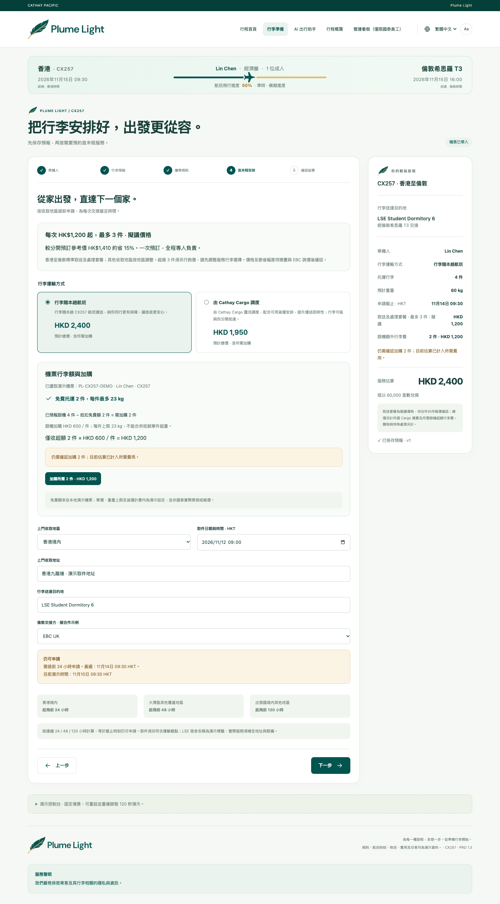

<p align="center">
  
</p>

# 泰易送 · 翼隨行 — Plume Light

<p align="center"><strong>輕裝啟程，安心抵達。</strong><br>Less to carry. More to discover.</p>

<p align="center">
  <a href="#界面預覽">界面預覽</a> ·
  <a href="#快速開始">快速開始</a> ·
  <a href="#產品功能與頁面導覽">頁面導覽</a> ·
  <a href="#推薦演示流程">演示流程</a> ·
  <a href="#開發與驗證">開發與驗證</a>
</p>

面向國泰航班旅客的行李準備與遞送服務概念原型，為 Cathay Hackathon 項目製作。旅客可以提前申報行李、諮詢攜帶規則、模擬預約上門收取及目的地配送；航司可通過營運看板查看已保存的行李預報，輔助裝載規劃。

**試點聚焦留學生與家庭。** 從香港的家到倫敦的新開始，把行李準備、取送安排和交接確認串成一段完整旅程。

項目使用原生 HTML、CSS 和 JavaScript，採用多頁面結構，無需安裝前端依賴或執行構建。**根目錄的 `index.html` 是唯一主入口。** 本說明位於根目錄 `README.md`。

> 當前為靜態交互演示，沒有接入真實訂票、付款、會員、物流或大模型服務。頁面中的價格、里數、時間、規則和交接事件均為演示數據。

## 界面預覽

### 一趟旅程，從提前準備開始


首頁把航班、行李準備入口、目的地和旅客故事放在一起。默認故事圍繞 Lin Chen 的 `HKG → LHR` 留學旅程展開，行李送達 `LSE Student Dormitory 6`。

| 出發前 | 預約時 | 抵達後 |
| --- | --- | --- |
| 填寫行李，先問清攜帶規則 | 比較隨航班與 Cargo，核對現金及里數 | 查看機場到達、裝機和當地物流交接三項確認 |

<details>
<summary><strong>查看首末程安排：取送服務與運輸方案比較</strong></summary>



香港取送套餐擬議價格為每次 HK$1,200，最多 3 件。頁面分別列出取送費、額外托運行李費或 Cargo 運費；切換運輸方式後，總價與里數隨之更新。

</details>

<details>
<summary><strong>查看營運看板：從行李預報到裝載規劃參考</strong></summary>


旅客保存的最新預報會進入看板，與其他演示旅客數據彙總。已知重量和未申報補估分別展示，方便解釋規劃餘量如何變化；最終配載仍由航司確認。

</details>

以上截圖來自當前頁面的默認繁體中文演示場景，使用項目本地素材。

### 先認識兩位試點場景中的旅客

<table>
  <tr>
    <th width="50%">Lin · 獨自赴英升學</th>
    <th width="50%">Alex · 與家人提前安排旅程</th>
  </tr>
  <tr>
    <td align="center"></td>
    <td align="center"></td>
  </tr>
  <tr>
    <td><strong>香港 → 倫敦</strong><br>兩隻行李箱、兩箱書籍衣物。提前填寫行李資料，安排宿舍配送，把抵達後的精力留給入住和新生活。</td>
    <td><strong>深圳 → 香港 → 墨爾本</strong><br>家人在家協助填寫預報和跨境取件資料，由目的地家人接收行李；兒童乘機服務另按航司流程確認。</td>
  </tr>
</table>

人物與故事均為虛構，配圖為項目已有的 AI 生成素材。首頁另有研究學者案例，用於展示後續擴展場景；行動不便旅客服務按 deck 規劃於 2029 年以後拓展。

## 快速開始

### 直接打開

1. 下載或接收完整項目文件夾，並先解壓壓縮包。
2. 在文件夾根目錄雙擊 [index.html](index.html)。
3. 從首頁進入行李準備、AI 出行助手、行程概覽或營運看板。

至少保留 `index.html`、`assets/` 和 `pages/`，不要更改它們之間的相對位置。直接打開本地文件時，各瀏覽器的存儲行為可能不同；如遇到跨頁面數據無法保留，請使用本地服務器。

### 使用本地服務器

已安裝 Python 3 時，在項目根目錄運行：

```sh
python3 -m http.server 8000 --bind 127.0.0.1
```

然後訪問 <http://127.0.0.1:8000/>。按 `Ctrl+C` 結束服務器。

請在演示過程中使用同一個瀏覽器、網址和端口。`localhost`、`127.0.0.1`、不同端口及本地文件屬於不同的存儲環境，數據不會自動互通。

## 產品功能與頁面導覽

| 頁面入口 | 當前實現 | 建議體驗 |
| --- | --- | --- |
| [行程首頁](index.html) | CX257 航班橫幅、服務入口、三組虛構旅客案例與輪播 | 查看 Lin 的行程，切換人物故事 |
| [① 乘機人資料](pages/prepare.html) | 選擇實際乘機人、出行場景、協助需求和家人協助，填寫聯繫資料 | 切換乘機人，體驗家人協助填寫 |
| [② 行李預報](pages/baggage.html) | 添加或刪除物品，填寫件數、重量、尺寸，區分隨身與托運及是否購買遞送服務 | 修改重量，選擇需要取送的行李並保存 |
| [③ 攜帶規則](pages/rules.html) | 按目的地及物品屬性提供規則樣本、追問、來源說明和待確認提示 | 詢問充電寶，補充 `74 Wh` 後查看結果 |
| [④ 首末程安排](pages/delivery.html) | 選擇收取地區、取件時間、地址、接收人、擬合作物流方及運輸方式 | 比較隨航班與 Cargo 的預計總價 |
| [⑤ 確認結算](pages/checkout.html) | 查看費用及里數，模擬現金支付或里數兌換，保存訂單快照 | 核對免費額與加購，選擇一種模擬付款方式 |
| [AI 出行助手](pages/assistant.html) | 獨立諮詢入口，支持物品規則及價格、截止、配送等服務問題 | 先問“最遲什麼時候申請？”再進入預訂 |
| [行程概覽](pages/journey.html) | 查看訂單、模擬取消與退款，確認機場到達、裝機及當地物流交接 | 付款後展開交接演示，觀察逐件確認 |
| [營運看板](pages/operations.html) | 彙總已保存預報，展示重量、空間、估算值及規劃餘量，標注僅限國泰員工 | 對比修改並保存行李前後的規劃參考 |

上表鏈接用於定位項目文件；在 GitHub 中點擊會打開源碼。體驗交互請下載項目後打開首頁，或按「快速開始」中的方式啟動本地服務器。

全站支持繁體中文、英語、法語、西班牙語和阿拉伯語，提供大字模式、鍵盤操作及減少動畫偏好；阿拉伯語會切換為從右向左的佈局。

### 品牌與界面約定

- 中文項目名稱為「**泰易送 · 翼隨行**」，網站頁首與頁尾使用 **Plume Light** 橫版 Logo，頂欄標注 `CATHAY PACIFIC`。
- 淺色背景使用標準版 Logo，首頁深綠色主視覺使用反白版；羽毛圖標也用於行李標籤、預訂摘要、助手頭像和瀏覽器標籤圖標。
- 首頁及全部預訂步驟的底部展示服務聲明：「我們嚴格保密乘客及其行李相關的隱私與資訊。」
- 營運入口及看板頁明確標注「僅限國泰員工」。目前這是界面用途說明，尚未實現員工登錄或訪問權限校驗。

### 運輸方式

行李預報僅填寫件數、重量、尺寸及服務需求。完成預報後，在「首末程安排」統一選擇運輸方式，並實時比較兩種方案的預計總價：

| 選項 | 頁面表達 |
| --- | --- |
| 行李隨本趟航班 | 與當前 CX257 旅程同行，強調旅客的安心感 |
| 由 Cathay Cargo 調度 | 使用靈活貨運調度，強調運輸及時性，並說明行李可能分開抵達 |

選擇會跨頁面保存，並進入結算摘要和訂單快照；Cargo 訂單的裝機說明也會顯示 Cathay Cargo。兩種方式使用不同演示運價，共用地區申請截止邏輯；沒有接入實際貨運排期、艙位分配或到達承諾。

### 機票免費額識別與加購

系統從當前機票的 `flight.baggageAllowance` 讀取乘機人的免費額度，按 `bookingId` 和 `travellerId` 匹配。默認演示成人票為免費 2 件、每件 23 kg；兒童票為免費 1 件、每件 23 kg。這些是本地票據樣本，並非從國泰實際出票系統提取的規則。

- 隨航班方案按當前乘機人的全部托運行李核對額度，包括未購買遞送服務的托運行李。
- 系統自動抵扣免費件數，只計算實際超出的件數，再由旅客一鍵確認加購。缺少確認時，預計總價已包含所需加購費，但不能繼續結算。
- 未超出免費額時，跟機行李費為 HKD 0，不收同航班安排費，也不要求加購確認；取件及目的地配送服務費仍單列。減少行李後，舊加購數量不能繼續產生超額費用。
- 免費額及加購數量按乘機人保存。額外件數不能合併用於抵銷單件超重；需先重新分裝或改選 Cargo。
- Cargo 行李不佔用機票免費額；未交給 Cargo 的托運行李仍按機票額度檢查和加購。
- 切換運輸方式、數量或行李資料會更新總價、里數及現金收益。訂單保存確認時的免費額、加購數量和費用快照。

| 新增演示費率 | 參數 |
| --- | --- |
| 免費額內跟機行李 | HKD 0，無同航班安排費 |
| 跟機額外托運行李 | 每件 HKD 600，沿用票據的單件重量上限 |
| Cargo 運費 | 每件每 23 kg 或不足一單位 HKD 250 |
| Cargo 計費重量 | 每件取實重與體積重的較高者，體積重 = 長 × 寬 × 高（cm）÷ 6000，再逐件向上取整計費單位 |

取送服務費按每次最多 3 件的套餐及收取地區系數計算。Cargo 的額外運輸單價較低；具體總價還受重量、體積、地區與跟機剩餘行李影響，不能保證任意行李組合下都更便宜。

## 目錄與頁面

```text
Cathay_Pacific/
├── index.html                  # 唯一主入口
├── pages/                      # 當前功能頁面
│   ├── prepare.html            # 乘機人及聯繫資料
│   ├── baggage.html            # 行李預報
│   ├── rules.html              # 預訂流程內的規則諮詢
│   ├── delivery.html           # 首末程及運輸方式
│   ├── checkout.html           # 確認與模擬結算
│   ├── assistant.html          # 獨立 AI 出行助手入口
│   ├── journey.html            # 訂單及交接狀態
│   └── operations.html         # 營運看板
├── assets/                     # 共用腳本、樣式與本地圖片
│   ├── app.js
│   ├── model.js
│   ├── i18n.js
│   ├── styles.css
│   ├── plume-feather.png
│   ├── cathay-brushwing.png
│   ├── cathay-brushwing-white.png
│   └── traveller-*.png
├── doc/                        # 需求、分鏡、配圖說明及 README 截圖
│   └── images/                 # 當前首頁、首末程安排與營運看板截圖
├── archive/                    # 保留的舊版原型
│   ├── index-original.html
│   └── index-prd-single.html
└── tools/                      # 輔助腳本與驗證，非網站運行依賴
    ├── test.py
    └── tests/pricing.cjs       # 行李額度、計價與訂單回歸驗證
```

`archive/` 中的頁面用於追溯歷史設計，其功能和文案可能與當前版本不同。`tools/test.py` 是保留的簡單腳本；新增的 `tools/tests/pricing.cjs` 驗證額度、計價、訂單快照及退款邏輯。

## 推薦演示流程

1. 打開首頁，展示 CX257 香港至倫敦希思羅 T3 的行程及目的地 `LSE Student Dormitory 6`；切換語言或大字模式。
2. 點擊「行李準備」，確認實際乘機人及聯繫人；需要時選擇家人協助填寫。
3. 修改行李重量、尺寸或服務選擇，並保存預報。未保存的草稿不會計入營運統計。
4. 在攜帶規則頁詢問充電寶等物品，並按提示補充規格，例如 `74 Wh`；查看規則樣本及待確認說明。
5. 選擇收取地區、取送信息及「隨本趟航班」或「Cathay Cargo 調度」。
6. 核對報價，勾選模擬交易確認，選擇現金或里數結算，進入行程概覽。
7. 展開交接事件演示，依序確認到達機場、部分或全部裝機、當地物流接收；服務完成後再查看里數入賬。
8. 查看營運看板，觀察已保存申報及重量、空間餘量變化；最後回到首頁查看旅客案例。

頁面底部的演示控制台可切換留學生、兒童家庭、超過截止時間、缺少尺寸等場景，並調整演示時鐘、航班時間、規則質量或模擬支付失敗。

## 演示參數與業務約束

### 默認場景

- 航班：`CX257`，`HKG → LHR T3`，Lin Chen 乘坐經濟艙。
- 出發：2026 年 11 月 15 日 09:30，香港時間。
- 初始演示時鐘：2026 年 11 月 10 日 09:30，香港時間；不會自動隨系統日期推進。
- 默認托運行李：4 件，總重 60 kg；其中 3 件選用取送服務，共 50 kg，餘下 1 件隨旅客航班托運。
- 香港取送服務擬議價格：每次 HK$1,200，最多 3 件；額外托運行李費或 Cargo 運費另計。
- 默認可用里數：100,000。
- 默認隨航班方案（4 件均隨航班，其中 3 件取送）：取送 HKD 1,200 + 超出免費額的 2 件 HKD 1,200 = HKD 2,400；需 60,000 里數兌換，現金訂單預計賺取 240 里數。
- 默認 Cargo 方案（3 件經 Cargo，餘下 1 件隨航班且在免費額內）：取送 HKD 1,200 + Cargo 運費 HKD 750 = HKD 1,950；需 48,750 里數兌換，現金訂單預計賺取 195 里數。Cargo 樣本計費重量為 56 kg，逐件取整後共 3 個計費單位。

上述價格依賴默認行李、地區及尺寸；修改選項後以頁面重新計算的演示報價為準。

### 申請截止

| 收取地區文案 | 至少提前申請 | 取件距起飛的最少間隔 |
| --- | --- | --- |
| 香港境內 | 24 小時 | 12 小時 |
| 大灣區其他覆蓋地區 | 48 小時 | 24 小時 |
| 出發國境內其他地區 | 120 小時 | 72 小時 |

以當前演示航班的香港出發時刻計算連續小時，恰好等於申請截止時刻仍可申請。取件時間還須符合單獨的運輸截點。其他未覆蓋地區不能新建預約。

「出發國境內其他地區」是當前顯示名稱；代碼沿用地區鍵 `mainland` 及相應演示參數，尚未實現按任意出發國動態配置覆蓋範圍。

### 行李、訂單與里數

- 全部托運行李預報與購買首末程服務的行李分別統計；服務報價只計算選中的托運行李。
- 同一乘機人及航段按最新有效申報統計。未知重量不當作零；報價需要完整重量與尺寸。
- 演示匯率為 GBP 1 = HKD 10；每 HKD 1 可用 25 里數兌換；每 HKD 10 合資格現金預計賺取 1 里數。這些是代碼演示參數，不是現行會員政策。
- 全額里數兌換訂單賺取 0 里數。付款失敗會釋放凍結里數；取消按訂單快照處理退款與已入賬里數衝銷。
- 訂單保存確認時的資料和運輸方式；後續草稿修改不會改寫已有訂單。
- 付款成功或航班進度變化不會自動確認行李裝機。交接按行李件數確認，可展示部分完成，並防止相同事件重複累計。
- 營運看板的餘量是演示預測，未接入真實航班載重或貨運銷售系統。

## AI 助手與案例

助手由本地意圖識別、屬性追問和確定性規則樣本驅動，沒有調用大模型 API 或實時官方檢索。覆蓋衣物書籍、電池、輔助設備、液體、藥品、食品、電子與易碎品，以及截止、價格、里數、交接、家人協助和配送等服務問題。

英國、澳洲及印度提供有限規則樣本，法國作為未覆蓋目的地示例。缺失、過期、衝突及未覆蓋結果會保留待確認提示。諮詢其他目的地不會修改當前機票；可回寫的行李建議需要用戶確認，且不能靜默更改已有服務訂單。

首頁三組案例分別為留學生赴倫敦、兒童赴墨爾本，以及日本研究學者返回札幌。案例人物、結果及引述均為虛構，配圖為 AI 生成素材；案例航線不會更改實際演示訂單或複用倫敦報價。

輪播在可見時每 8 秒切換；懸停、鍵盤聚焦、頁面隱藏或離開可視區時暫停，也支持按鈕、圓點、鍵盤、觸屏及觸控板橫向手勢。

## 技術與數據存儲

| 文件 | 職責 |
| --- | --- |
| [assets/app.js](assets/app.js) | 頁面映射、共用品牌及導航、表單渲染、跳轉、案例輪播和事件處理 |
| [assets/model.js](assets/model.js) | 狀態、校驗、預報彙總、容量預測、報價、訂單、里數及規則樣本 |
| [assets/i18n.js](assets/i18n.js) | 五種語言文案、變量替換、語言偏好及文檔方向 |
| [assets/styles.css](assets/styles.css) | 品牌樣式、響應式佈局、大字模式及減少動畫偏好 |

數據保存在瀏覽器 `localStorage`，不會在不同瀏覽器或設備間同步：

| 鍵名 | 用途 |
| --- | --- |
| `plume-light-multipage-v2` | 表單草稿、已保存預報、訂單、交接事件、演示設置及里數狀態 |
| `plume-light-language` | 用戶選擇的界面語言 |

頁面刷新及跨頁跳轉會保留可存儲的數據。存儲不可用時，刷新或跳轉可能丟失修改。可通過演示控制台恢復預設場景；需要完全清空時，可在瀏覽器開發者工具中刪除上述兩個存儲項後刷新。

語言列表為 `zh-Hant`、`en`、`fr`、`es`、`ar`；阿拉伯語使用從右向左佈局。用戶輸入的姓名、地址及問題原文不會自動翻譯。

## 開發與驗證

修改時請遵守以下約定：

1. 保留根目錄 `index.html`、`pages/` 和 `assets/` 的層級。頁面映射由 `PAGE_FILES` 管理，子頁面通過 `ROOT_PREFIX` 返回根目錄資源。
2. 各頁面的腳本順序保持 `i18n.js → model.js → app.js`，並正確設置 `<body data-page="...">`。
3. 新增界面文案時，在 `i18n.js` 同時填寫五種語言；不要把顯示標籤直接作為業務狀態鍵。
4. 保留未知值、草稿與提交、申報與服務需求之間的區別。不要用航班起飛、付款或頁面動畫推導行李狀態。
5. 圖片隨項目本地保存；修改路徑後同時檢查首頁、子頁面和分享版。

如已安裝 Node.js，可在項目根目錄進行語法檢查；Node.js 不屬於網站運行依賴：

```sh
node --check assets/i18n.js
node --check assets/model.js
node --check assets/app.js
node tools/tests/pricing.cjs
```

修改後應手動檢查首頁與全部八個功能頁、返回首頁、五步預訂、現金及里數模擬支付、取消訂單、運輸方式保存、交接狀態、語言切換和手機佈局。語法檢查不能替代瀏覽器中的交互驗證。

## 分享與靜態部署

分享版至少包含以下文件，解壓後從 `index.html` 開始使用：

```text
index.html
assets/
pages/
README.md                      # 建議附帶
```

`archive/`、`tools/`、其餘開發文檔及 `.git/` 不需要隨運行版分發。修改網站或本說明後，請重新生成分享包；舊壓縮包不會自動更新。

也可將上述目錄原樣部署到支持靜態文件的託管服務。無需構建，入口設為 `index.html`，並保留 `pages/` 和 `assets/` 的相對路徑。當前沒有配置公開訪問網址或自動部署流程。

## 常見問題

| 問題 | 處理方式 |
| --- | --- |
| 打開首頁後空白 | 確認已解壓、JavaScript 已啟用，且 `assets/` 中三個腳本未遺漏 |
| 子頁面或圖片無法打開 | 恢復原有目錄層級；只複製 `index.html` 無法運行完整網站 |
| 切頁後訂單、語言或草稿消失 | 使用同一瀏覽器和同一來源；本地文件模式異常時改用本地服務器 |
| 預約顯示超時或取件時間無效 | 檢查演示控制台中的當前時間、航班時間、地區截止及取件時段 |
| 無法獲取報價 | 確認至少選擇一件需要服務的托運行李，並補全其重量與尺寸 |
| 付款後行李仍未裝機 | 展開行程頁的交接事件演示，按順序模擬交接確認 |
| 看板與剛輸入的重量不同 | 先保存行李預報；看板只讀取有效提交，且包含其他演示旅客的基線數據 |

## 相關文檔與當前邊界

- [產品需求與演示指導（PRD 1.3）](doc/Plume_Light_PRD.md)
- [前端演示與實現記錄](doc/FRONTEND_DEMO.md)
- [視頻分鏡 v2.2](doc/Plume_Light_Video_Storyboard_v2.2.md)
- [人物配圖與生成記錄](doc/IMAGE_ASSETS.md)

需求與分鏡保留各自版本的設計背景；品牌、運輸選項及頁面路徑等後續改動，以當前實現和本 README 為準。

當前版本沒有服務端、賬戶體系、員工鑑權、真實數據加密服務、支付渠道、官方規則檢索或物流回傳。界面的隱私聲明屬於產品服務文案，不能替代正式上線時的數據保護實現；演示請使用虛構資料。真實使用需要另行接入相應系統，並由服務端處理身份驗證、權限、報價與截止校驗、支付、會員賬本及承運確認。
