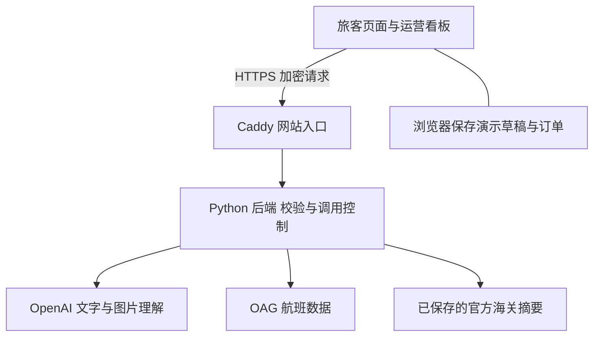

# Plume Light 后端技术说明

面向比赛评委与团队讲解　2026 年 11 月 14 日

Plume Light 的后端把 AI、航班数据和行李服务页面连接起来：旅客可以结合自己的行程提问、上传物品照片、辅助填写行李资料；运营人员可以查询航班并评估中转时间。目前已公开部署，是可运行的比赛原型。

## 一句话说明

后端像一个服务台：接收网页请求，检查资料是否合适，再向 OpenAI、OAG 或已保存的政策资料获取信息，把结果交回网页。API key 保留在服务器上。

## 架构与分工

网站运行在 Google Cloud 虚拟机上。Caddy 负责 HTTPS；Python 服务处理 API；systemd 负责开机启动和进程异常退出后的重启。前端与后端使用同一网址。

前端还负责页面交互、演示报价、中转时间计算和候选航班排序。后端负责外部接口访问、密钥管理、输入校验、政策资料读取，以及估算结果的检查与计算。浏览器传来的订单和报价属于演示状态，并非服务器核实过的正式业务记录。

## 当前能够演示的能力

| 能力 | 实际实现 | 需要说明的边界 |
| --- | --- | --- |
| AI 出行助手 | 使用 GPT-4.1 mini，结合行程回答文字和图片问题，支持逐段显示回答 | 模型可能出错，不代表官方批准 |
| 海关资料辅助 | 按目的地读取带官方链接和核查日期的摘要 | 保存的摘要，不是每次实时联网查法规 |
| 行李估算填表 | 返回规定格式的数据，程序计算体积和重量合计，辅助填写指定草稿 | 估算不是测量，申报前仍需人工核对 |
| 航班与中转 | 后端接入 OAG；页面评估两段中转并推荐候选后续航班 | 不订票、不改签，不保证行李赶上飞机 |
| 交接后查件 | 检查演示交接事件，返回稳定的 DEMO 运单编号 | 尚未接入物流公司的真实运单 |

## 一次图片咨询怎样完成

1. 用户选择照片，网页先压缩图片、去除原文件中的 EXIF/GPS 元数据，点击发送后才上传。
2. 后端检查文件类型、大小和对话长度，只保留需要的行程字段，再调用 OpenAI。
3. 涉及海关时，助手可读取已保存的官方摘要；回答展示来源、日期和需要进一步确认的条件。
4. 普通回答分段返回。只有用户点击“估算并填入行李”，系统才按独立流程校验估算数据并填写关联草稿；普通聊天不会修改表格。

例如，已知外尺寸为 70 × 45 × 30 cm，后端计算外部体积为 94.5 L；这不是箱内可用容量。只有一张无比例参照的箱子照片时，系统应要求补充尺寸或参照物，不能据此准确称重。

## 数据来源与安全

海关资料库目前涵盖英国大不列颠、中国内地、日本、香港和澳大利亚，共 17 条摘要、12 个官方来源，版本为 2026-11-14.1。各条资料有自己的适用范围，不能代表完整的航空、安检或海关规定。

OAG 查询默认缓存 5 分钟，并展示数据取得时间。遇到失败或过期数据，中转页面会暂停实时判断。默认 50 分钟是团队的演示规则，可以调整，不能称为机场官方最低中转时间。

OpenAI 和 OAG 的 key 都位于服务器私有文件，原文件仅 root 可读写，systemd 将凭据提供给后端进程。网页不会收到 key；有服务器管理权限的人仍可读取它。当前运行服务使用私有文件，尚未通过 Secret Manager 读取。

图片只在本应用的临时内存中处理，不写入本地订单存储或服务器文件；文字对话和演示订单保存在浏览器。选定图片仍会发给 OpenAI，图片中可见的个人信息不会自动遮盖。`store: false` 不等于供应商承诺零保留。

## 容量与下一步

当前是一台虚拟机上的单进程服务。AI 请求限制为同时 2 轮、每分钟 20 轮；OAG 默认每进程滚动 24 小时最多 100 次上游调用。进程重启会重置这些内存计数，它们不是账户级硬性费用上限。

正式上线还需要真实用户登录、服务端权限与数据库、后台报价校验、支付与物流对接、共享缓存和限额、监控及容量测试。目前的跨站请求检查不能替代身份验证，公开演示服务不应承载真实敏感订单。

## 演示入口与核验依据

- 演示网站：https://plume-light.34-80-39-148.sslip.io
- AI 助手：`/pages/assistant.html`；运营看板：`/pages/hold-pressure/index.html`。
- 本次只读核验确认线上版本为 `assistant-callouts-20261114-1515`，服务正常，OpenAI 与 OAG 均已配置。配置状态不等于每次上游调用成功。
- 部署记录已有真实 AI 对话、图片估算和 OAG 查询验证；本次文档整理未重新执行这些收费调用或完整测试。

进一步核查可阅读 [AI 接入说明](../AI_AGENT.md)、[OAG 接入说明](../oag/OPERATIONS_INTEGRATION.md)及[部署记录](../../deploy/vm/README.md)。实现分别位于 `tools/serve.py`、`tools/assistant.py`、`tools/baggage_estimate.py`、`tools/customs_policy.py`、`tools/oag.py`；前端中转与推荐逻辑位于 `kanban-app/src/services/`。
