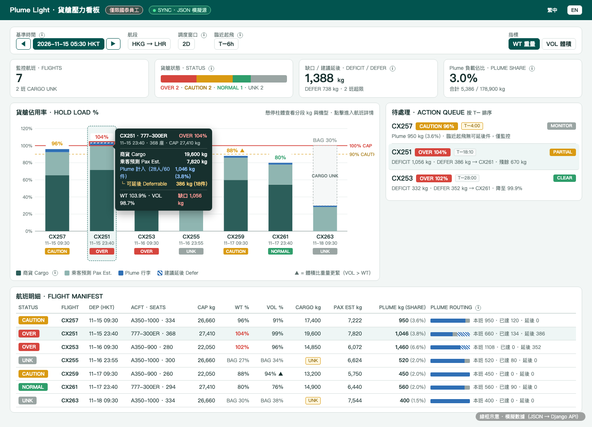
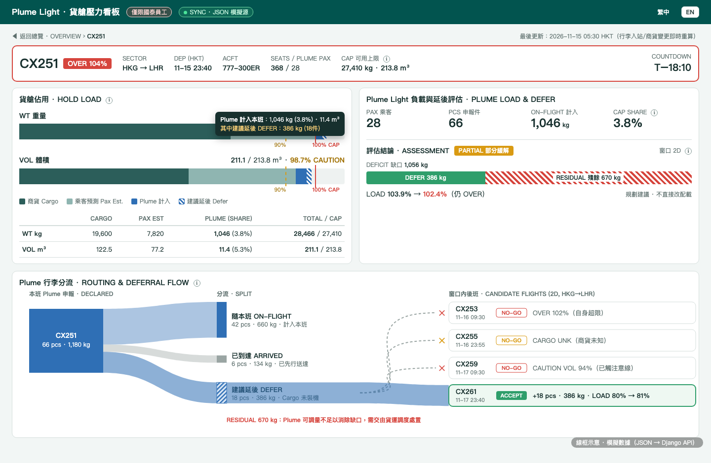

# 貨艙壓力看板 · 計劃（v0.5）

> **v0.5 更新**：
> 1. **柱面去噪 + 懸浮詳情**：柱體只留頂部 `LOAD %`、底部 `FLIGHT / DEP / STATUS`；分段 kg、機型座位、Plume 佔比、缺口全部移入懸浮框。配圖已重繪。
> 2. **React 前端 + JSON → Django 架構**：前端改用 **React** 構建交互式看板；本期讀本地 **JSON 快照 + 時間/事件模擬流**，預留同構 API 層，後期無縫切 **Django（REST + SSE/WebSocket）**。
> 3. **雙語**：控制條一鍵切換 **繁中 / EN**，術語對齊機坪與簽派口令。
> 4. **審核結論（§5）**：以「0 點擊看大盤、1 懸停知構成、1 點擊見分流」驗證三類核心問題。

---

## 1. 口徑鎖定

| 項目 | 口徑 |
|---|---|
| Plume 行李 | 訂購 Plume Flight 乘客之已申報托運行李；僅選 **Cargo** 且未裝機者可延後（`DEFER`） |
| 乘客預測 `PAX EST` | 非 Plume 乘客：（座位數 − Plume 人數）× 23 kg；體積 × 0.227 m³/人（參數可調） |
| 可用上限 `CAP` | 按機型取規劃上限：A350-900 `22,050 kg / 172 m³`；A350-1000 `26,660 kg / 208 m³`；777-300ER `27,410 kg / 213.8 m³`。當班可覆寫 |
| 商貨 `CARGO` | **固定不可移**；未確認時標 `CARGO UNK`，只報行李佔用 `BAG n%`，不判超限、不收延後件 |
| 狀態閾值 | `OVER` ≥100%；`CAUTION` 90–100%；`NORMAL` <90%；承接後班上限 = **承接後仍 <90%**（重、體雙控） |
| 動態數據 | 隨 **基準時間推進（T−）** 與 **現場反饋事件**（旅客新增申報、行李入站/先行送達、裝機截止、商貨訂艙更新）實時重算 |

---

## 2. 界面與交互（已更新配圖）

### 2.1 總覽（Overview）



- **頂欄與控制條**：`SYNC` 數據源狀態燈 · **繁中 / EN** 切換 · 基準時間（可撥動預演或跟隨實時流）· 航段 · 調度窗口（`1D / 2D / 3D`）· 臨近起飛閾值（`T−6h`）· 指標切換（`WT 重量 / VOL 體積`）。
- **四張 KPI 卡**：`FLIGHTS`（含 UNK 數）· `STATUS` 分佈條 · `DEFICIT / DEFER` 合計 · `PLUME SHARE`（Plume 佔總可用量 % 與總重）。
- **主圖（堆疊柱）— 極簡柱面 + 懸浮浮窗**：

| 柱面常顯（4 項） | 懸浮浮窗（Hover / 鍵盤聚焦 / 觸屏點按） |
|---|---|
| ① 柱頂 `LOAD %`（體積更緊時附 `▲`；商貨未知標 `BAG n%`） | 航班 · 機型 · 座位 · `CAP` 上限 |
| ② `100% CAP` 紅實線、`90% CAUTION` 黃虛線 | 分段明細：`商貨 Cargo` / `乘客預測 Pax Est.` / `Plume 計入（人/件/kg/佔比%）` |
| ③ 超限紅框、未知虛線框（`CARGO UNK`）、斜紋段（`DEFER`） | `└ 可延後 Deferrable`（件數 + kg） |
| ④ 柱底：`航班號`、`起飛時刻`、`狀態簽（OVER / CAUTION / NORMAL / UNK）` | `WT %` · `VOL %` · `DEFICIT 缺口` |

- **待處理隊列（Action Queue）**：自動篩出 `CAUTION / OVER` 及臨近起飛航班，每行直接給出 `DEFICIT`、`DEFER → 目標航班`、結論簽（`CLEAR / PARTIAL / MONITOR`）。點擊聯動高亮柱體或直達詳情。
- **航班明細表（Flight Manifest）**：保留完整數字與 `PLUME kg (SHARE)`，右側微型分流條直觀顯示「隨本班 · 已達 · 延後」比例。

### 2.2 航班詳情（Flight Detail · 含分支圖）



- **頂部狀態橫幅**：航班號 + `OVER / CAUTION` 簽、航段、起飛、機型、座位 / Plume 人數、`CAP` 上限（支持當班覆寫）、`T−` 倒計時。
- **左上 `HOLD LOAD`**：`WT` 與 `VOL` 兩條橫向堆疊進度條。**條內不塞數字**，懸停分段彈出具體 kg / m³ 與佔比；下方配緊湊對照表。
- **右上 `PLUME LOAD & DEFER`**：4 個核心讀數（`PAX`、`PCS`、`ON-FLIGHT kg`、`CAP SHARE %`）+ 評估結論條（綠段 `DEFER` + 紅斜紋 `RESIDUAL`），一行讀出 `LOAD 103.9% → 102.4%`。
- **下方 `ROUTING & DEFERRAL FLOW`（橫向分支圖）**：
  - 左：本班申報總量（件 · kg）。
  - 中：三路分流 — `ON-FLIGHT 隨本班` / `ARRIVED 已到達` / `DEFER 建議延後`（線寬 = 重量）。
  - 右：窗口內候選後班。可接標綠 `ACCEPT` 並顯示接收後負載變化（`80% → 81%`）；不可接以虛線 `✕` 斷開並標 `NO-GO` 與原因（`OVER` / `CARGO UNK` / `CAUTION VOL`）。

---

## 3. 技術架構：React 前端 + JSON 臨時源 → Django 實時後端

### 3.1 為什麼這樣選（克制、不重度封裝）

| 層級 | 本期（Demo / JSON 驅動） | 後期（Django 生產接入） | 選型理由 |
|---|---|---|---|
| **視圖與交互** | **React 18 + Vite**（TypeScript 可選） | 不變 | 柱體懸停、時間軸撥動、窗口參數切換、中英切換均為高頻局部狀態更新，React 組件化比手寫 DOM 拼接更穩 |
| **圖表渲染** | **React 直接渲染受控 SVG**（堆疊柱 + 橫向桑基分支圖） | 不變 | 第三方圖表庫（Recharts/ECharts）難以精確繪製「斜紋延後段 + 超限紅框 + 斷線 `✕` 拒收原因」；React 原生 `<svg>` 代碼不到 200 行，零黑盒 |
| **懸浮層** | **`@floating-ui/react`** | 不變 | 自動處理邊界碰撞、鍵盤聚焦（`Tab`）與觸屏點按，保證柱圖 Tooltip 不出屏 |
| **數據拉取與實時流** | **`@tanstack/react-query`** + 本地 `/data/kanban-snapshot.json` & 事件模擬器 | 同一套 Hook 指向 Django `/api/v1/kanban/...` + **SSE / WebSocket** | 組件只調 `useFlightsSnapshot(params)`，切換 Django 時 **UI 層零改動** |
| **多語種** | 輕量雙語字典 Hook `useI18n()`（`zh-Hant` / `en`） | 不變 | 詞條僅 ~60 個，無需引重型 i18n 框架 |

### 3.2 數據隨「時間與反饋」動態更新機制

看板不是死表，數據受兩類信號驅動並即時重算：

1. **時間推進（Time Tick）**
   - 隨 `asOfTime` 推進，`T−` 倒計時更新；
   - 進入 `T−6h` 的 `CAUTION / OVER` 航班自動推入右側 `ACTION QUEUE`；
   - 跨過裝機截止時間（如 `T−3h`）的未處理 Plume Cargo 行李自動鎖定為不可延後，`DEFER` 重算。
2. **現場反饋事件（Feedback Stream）**
   - `PLUME_DECLARED`：旅客在前端新增/修改行李預報 → 本班 `Plume kg` 與 `LOAD %` 即時上浮；
   - `BAG_ARRIVED_EARLY`：物流回傳某批 Cargo 行李已先行抵港 → 轉入 `ARRIVED`，從本班負載剔除；
   - `CARGO_UPDATED`：貨運部門填入/更新商貨噸數 → `CARGO UNK` 航班轉為 `NORMAL / CAUTION / OVER`，並立刻加入後班承接池；
   - `CAP_OVERRIDDEN`：當班簽派因油量/天氣下調 `CAP` → 觸發全窗口重算。

### 3.3 前後端數據契約（JSON 與 Django 共用 Schema）

```json
{
  "asOf": "2026-11-15T05:30:00+08:00",
  "sector": "HKG-LHR",
  "windowDays": 2,
  "nearHours": 6,
  "aircraftSpecs": {
    "A350-900":  { "capKg": 22050, "capM3": 172.0, "seats": 280 },
    "A350-1000": { "capKg": 26660, "capM3": 208.0, "seats": 334 },
    "777-300ER": { "capKg": 27410, "capM3": 213.8, "seats": 368 }
  },
  "flights": [
    {
      "id": "CX251",
      "dep": "2026-11-15T23:40:00+08:00",
      "aircraft": "777-300ER",
      "seats": 368,
      "capOverride": null,
      "cargoKg": 19600,
      "cargoM3": 122.5,
      "plumePax": 28,
      "plumeBags": [
        { "bagId": "PL-901", "kg": 24, "m3": 0.19, "mode": "cargo", "state": "staged" }
      ]
    }
  ]
}
```

- **本期（JSON 模式）**：前端 `DataService` 讀取 `public/data/kanban-snapshot.json`，並融合 `localStorage` 中旅客剛在「行李預報」頁提交的 CX257 訂單；頂欄提供「模擬時間推進 / 模擬商貨填入」觸發器以演示動態反饋。
- **後期（Django 模式）**：
  - `GET /api/v1/kanban/snapshot?sector=HKG-LHR&as_of=...` 返回同構 JSON；
  - `PATCH /api/v1/kanban/flights/{id}/capacity` 覆寫當班可用上限或商貨；
  - `GET /api/v1/kanban/stream`（Server-Sent Events）推送行李入站與預報變更。

---

## 4. 核心計算公式（純函數引擎 `kanbanEngine.ts`）

```text
CAP           = 當班覆寫值 ?? 機型規劃上限（WT kg、VOL m³ 各一）
CARGO         = 營運輸入（可為 null）；無實測體積時 VOL = WT ÷ 160 kg/m³
PAX EST       = (SEATS − PLUME_PAX) × 23 kg ； VOL = 人數 × 0.227 m³
PLUME ON-FLT  = 本班已申報 Plume 行李 − ARRIVED（已先行送達）
TOTAL         = CARGO + PAX EST + PLUME ON-FLT
LOAD %        = TOTAL ÷ CAP（WT% 與 VOL% 各算，取高者定狀態；VOL > WT 時標 ▲）
STATUS        = CARGO 為 null → UNK；LOAD ≥ 100% → OVER；90–100% → CAUTION；< 90% → NORMAL
DEFICIT       = max(0, TOTAL − CAP)
ACCEPT CAP    = max(0, 90% × 後班 CAP − 後班 TOTAL)   （WT、VOL 皆須滿足；UNK 後班不接）
DEFERRABLE    = 本班 Plume 中 mode='cargo' 且未裝機（T > 截止線）且窗口內有後班
DEFER         = 由大到小揀選 DEFERRABLE 行李填入最近且 ACCEPT CAP 足夠的後班，直至覆蓋 DEFICIT
ASSESSMENT    = DEFER ≥ DEFICIT → CLEAR；0 < DEFER < DEFICIT → PARTIAL；DEFER = 0 → NO-GO
```

---

## 5. 看板審核：能否在「簡潔、低交互成本」下回答你的問題？

### 5.1 使用者視角審核（3 秒 / 1 次懸停 / 1 次點擊）

| 你的核心問題 | 使用者怎麼看（交互步驟） | 畫面給出的精確答案 | 審核結論 |
|---|---|---|---|
| **① 目前各航班的貨艙情況如何？哪班有風險？** | **0 點擊（看總覽首屏）**：掃一眼頂部 `STATUS` 條、主圖紅/黃柱與右側 `ACTION QUEUE` | 7 班中 `OVER 2`（CX251 104%、CX253 102%）、`CAUTION 2`（CX257 96%、CX259 體積 94% ▲）、`NORMAL 1`、`CARGO UNK 2` | **通過**。柱面去掉段內數字後，紅線、超限紅框與 `▲` 體積緊迫標記一目了然 |
| **② Plume Light 行李負載佔多少？構成如何？** | **1 次懸停（Hover 任一航班柱）** 或看第 4 張 KPI 卡 / 明細表 `PLUME kg (SHARE)` 列 | 全局 Plume 佔總可用量 `3.0% (5,386 kg)`；懸停 CX251 即見：`Plume 計入 1,046 kg (3.8%)，28 人 / 60 件，其中可延後 386 kg (18 件)` | **通過**。平常不搶視覺，懸停即得精確到件數、重量、佔比與可延後量的全套數據 |
| **③ 超限時能否把 Plume Cargo 行李挪後班？去哪班？為何不去別班？** | **1 次點擊（點 CX251 柱或待處理行 → 進詳情頁）** | 右上給結論 `PARTIAL（缺口 1,056 → 延後 386 → 殘餘 670 kg，LOAD 103.9% → 102.4%）`；下方分支圖展示 `386 kg → CX261 (80%→81%)`，並用 `✕` 標明 CX253 超限、CX255 商貨未知、CX259 體積觸線 | **通過**。因果鏈條在同一屏閉環，無需翻頁或查表 |
| **④ 臨近起飛（T−6h 內）有沒有超標告警？** | **0 點擊（看右側 `ACTION QUEUE` 置頂行）** | `CX257 · CAUTION 96% · T−4:00 · MONITOR`（起飛前無可延後件，僅告警） | **通過**。與遠期規劃同隊列呈現但用 `T−` 與 `MONITOR` 區分 |
| **⑤ 數據更新時（時間推進 / 新預報 / 商貨確認）能否即時反映？** | 控制條撥動時間或接收事件流（頂欄 `SYNC` 燈閃爍） | 倒計時、柱高、缺口、後班承接流向即時重算 | **通過**。純函數引擎保證毫秒級重算 |

### 5.2 發現並已修正的 2 個細節缺陷

1. **原 v0.4 柱面刪掉分段數字後，不點進詳情就看不到單班 Plume 佔比**：
   - *修正*：① 柱體懸浮框固定高亮一行 `Plume 計入：1,046 kg (3.8%)` 與 `└ 可延後：386 kg`；② 底部明細表改成 `PLUME kg (SHARE)`（如 `1,046 (3.8%)`）。不用進詳情也能橫向比較各班 Plume 負載。
2. **商貨未知（`CARGO UNK`）時，如何避免誤以為「很空」**：
   - *修正*：柱頂寫 `BAG 27%`（不寫 `27%`），上半段用灰虛線框滿至 100% 並標 `CARGO UNK`，從視覺上阻斷「還有 73% 空位可隨便塞」的誤讀。

---

## 6. 雙語術語表（繁中 / EN · 機坪口令風格）

| 代碼鍵 | 繁體中文 | English | 口徑說明 |
|---|---|---|---|
| `kb.status.over` | 超限 `OVER` | `OVER` | `LOAD ≥ 100%` |
| `kb.status.caution` | 注意 `CAUTION` | `CAUTION` | `90% ≤ LOAD < 100%` |
| `kb.status.normal` | 正常 `NORMAL` | `NORMAL` | `LOAD < 90%` |
| `kb.status.unk` | 商貨未知 `CARGO UNK` | `CARGO UNK` | 商貨未錄入，僅報 `BAG %` |
| `kb.metric.cap` | 可用上限 `CAP` | `CAP` | 機型規劃上限（可覆寫） |
| `kb.metric.load` | 佔用率 `LOAD` | `LOAD` | `TOTAL ÷ CAP` |
| `kb.metric.deficit` | 缺口 `DEFICIT` | `DEFICIT` | `max(0, TOTAL − CAP)` |
| `kb.metric.defer` | 建議延後 `DEFER` | `DEFER` | 可改乘後班之 Plume Cargo |
| `kb.metric.residual` | 殘餘缺口 `RESIDUAL` | `RESIDUAL` | `DEFICIT − DEFER` |
| `kb.assess.clear` | 可緩解 `CLEAR` | `CLEAR` | 延後後 `LOAD < 100%` |
| `kb.assess.partial` | 部分緩解 `PARTIAL` | `PARTIAL` | 可減輕但仍 `≥ 100%` |
| `kb.assess.nogo` | 無解 `NO-GO` | `NO-GO` | 無可延後件或無可接後班 |
| `kb.assess.monitor` | 僅監控 `MONITOR` | `MONITOR` | 臨近起飛，不執行延後 |
| `kb.flow.onFlight` | 隨本班 `ON-FLIGHT` | `ON-FLIGHT` | 計入本班負載 |
| `kb.flow.arrived` | 已到達 `ARRIVED` | `ARRIVED` | 已先行抵港，不計入本班 |

---

## 7. 模擬基準數據（用於 JSON 快照與單測斷言）

基準時間：`2026-11-15 05:30 HKT` · 航段：`HKG → LHR` · 窗口：`2D`。商貨為演示模擬值。

| 航班 | 起飛 | 機型 · 座位 | CAP kg / m³ | 商貨 kg | 乘客預測 kg | Plume 計入 kg (佔比) | WT % | VOL % | 狀態 |
|---|---|---|---|---|---|---|---|---|---|
| CX257 | 11-15 09:30 | A350-1000 · 334 | 26,660 / 208 | 17,400 | 7,222 | 950 (3.6%) | 95.9% | 90.9% | `CAUTION` · `T−4:00` |
| CX251 | 11-15 23:40 | 777-300ER · 368 | 27,410 / 213.8 | 19,600 | 7,820 | 1,046 (3.8%) | 103.9% | 98.7% | `OVER` |
| CX253 | 11-16 09:30 | A350-900 · 280 | 22,050 / 172 | 14,850 | 6,072 | 1,460 (6.6%) | 101.5% | 96.4% | `OVER` |
| CX255 | 11-16 23:55 | A350-1000 · 300 | 26,660 / 208 | 未知 | 6,624 | 520 (2.0%) | BAG 26.8% | BAG 33.8% | `CARGO UNK` |
| CX259 | 11-17 09:30 | A350-900 · 260 | 22,050 / 172 | 13,200（100.7 m³） | 5,750 | 450 (2.0%) | 88.0% | 94.0% ▲ | `CAUTION (VOL)` |
| CX261 | 11-17 23:40 | 777-300ER · 294 | 27,410 / 213.8 | 14,900 | 6,440 | 560 (2.0%) | 79.9% | 76.0% | `NORMAL` |
| CX263 | 11-18 09:30 | A350-1000 · 334 | 26,660 / 208 | 未知 | 7,544 | 400 (1.5%) | BAG 29.8% | BAG 37.6% | `CARGO UNK` |

- **CX251 斷言**：`DEFICIT = 1,056 kg`；申報 66 件 1,180 kg（`ON-FLIGHT 660` · `ARRIVED 134` · `DEFER 386`）；後班 CX253 `OVER`、CX255 `UNK`、CX259 `CAUTION VOL` 均 `NO-GO`；**CX261 `ACCEPT 386 kg`**（`80% → 81%`）；`RESIDUAL = 670 kg` → **`PARTIAL`**。
- **CX253 斷言**：`DEFICIT = 332 kg`；可延後 960 kg，取 14 件 `352 kg → CX261`，`LOAD` 降至 `99.9%` → **`CLEAR`**。CX261 累計承接 `738 kg` 後約 `83%`（仍 `< 90%`）。

---

## 8. 實施里程碑

| 階段 | 交付物 | 驗收標準 |
|---|---|---|
| **M1 數據契與引擎** | `public/data/kanban-snapshot.json` + `src/engine/kanbanEngine.ts` + 單測 | §7 全部斷言通過；時間推進與反饋事件重算無誤 |
| **M2 React 總覽頁** | 控制條（含繁中/EN、時間撥動）、KPI 卡、SVG 堆疊柱 + Floating UI 懸浮框、待處理隊列、明細表 | 柱面無段內數字；懸停即見完整分段與 Plume 佔比 |
| **M3 React 詳情與分支圖** | 頂部橫幅（支持當班覆寫 CAP/商貨）、雙進度條、Plume 評估卡、SVG 橫向分支圖 | 點擊任一航班流暢切換；改動窗口 `1D/2D/3D` 或模擬商貨填入時分支流向即時變化 |
| **M4 Django 接口對接（後期）** | Django REST Snapshot API + SSE 事件流 | 將 `DataService` 切換至 Django URL，前端組件零改動運行 |
